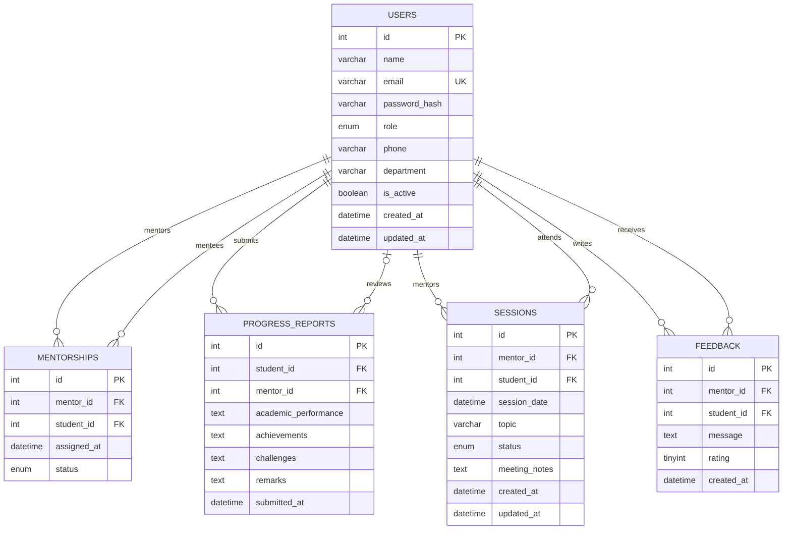

# Mentor–Mentee Portal — ER Diagram

A student's current mentor is the `mentorships` row with `status = 'active'`. Completed rows are retained as assignment history. In `schema.sql`, a generated nullable `active_student_id` column and unique index enforce at most one active mentor per student at the database level. User deletion is soft deactivation (`users.is_active = 0`) so historical records remain available.
